  <h1>LE QUOC HUY</h1>
  
<strong>Fullstack &bull; Mobile &amp; Web Developer</strong>

  <!-- Typing SVG Animation -->
  

    

  <!-- Terminal Component -->
  

    

  <!-- Minimalist Badges -->
  
  &nbsp;
  
  &nbsp;
  
  &nbsp;
  

 

---

### 🚀 Featured Work & Projects

- **Cross-Platform Mobile Apps** `Flutter` `React Native` `TypeScript`  
  Smooth, high-performance mobile applications with native device integrations, reactive state management, and offline local caching.

- **Fullstack Web Platforms & APIs** `React` `NodeJS` `SQL` `Java`  
  Scalable web applications and RESTful APIs built with clean architecture, robust security, and optimized database queries.

---

  <em><strong>"Turning complex problems into clean, elegant code."</strong></em>

